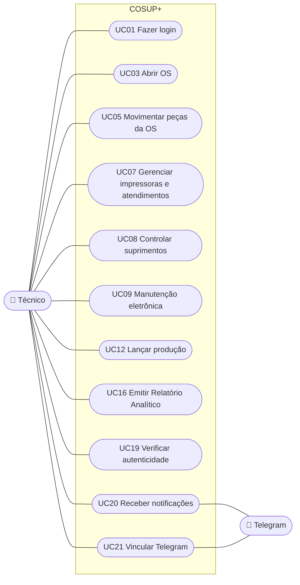
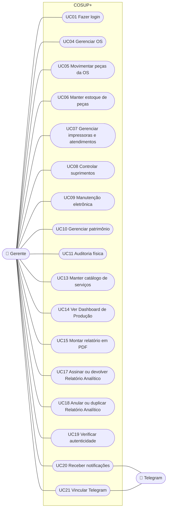
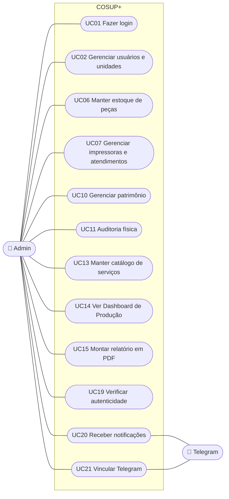
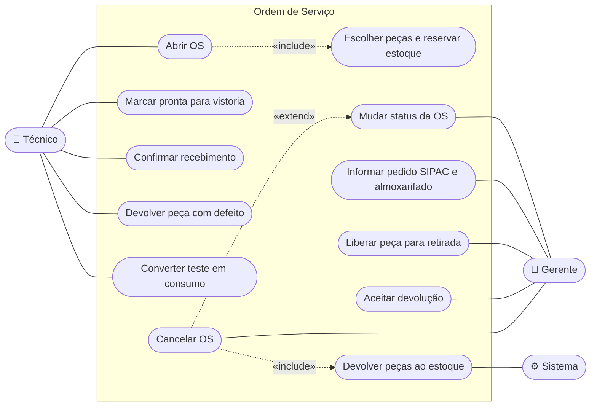
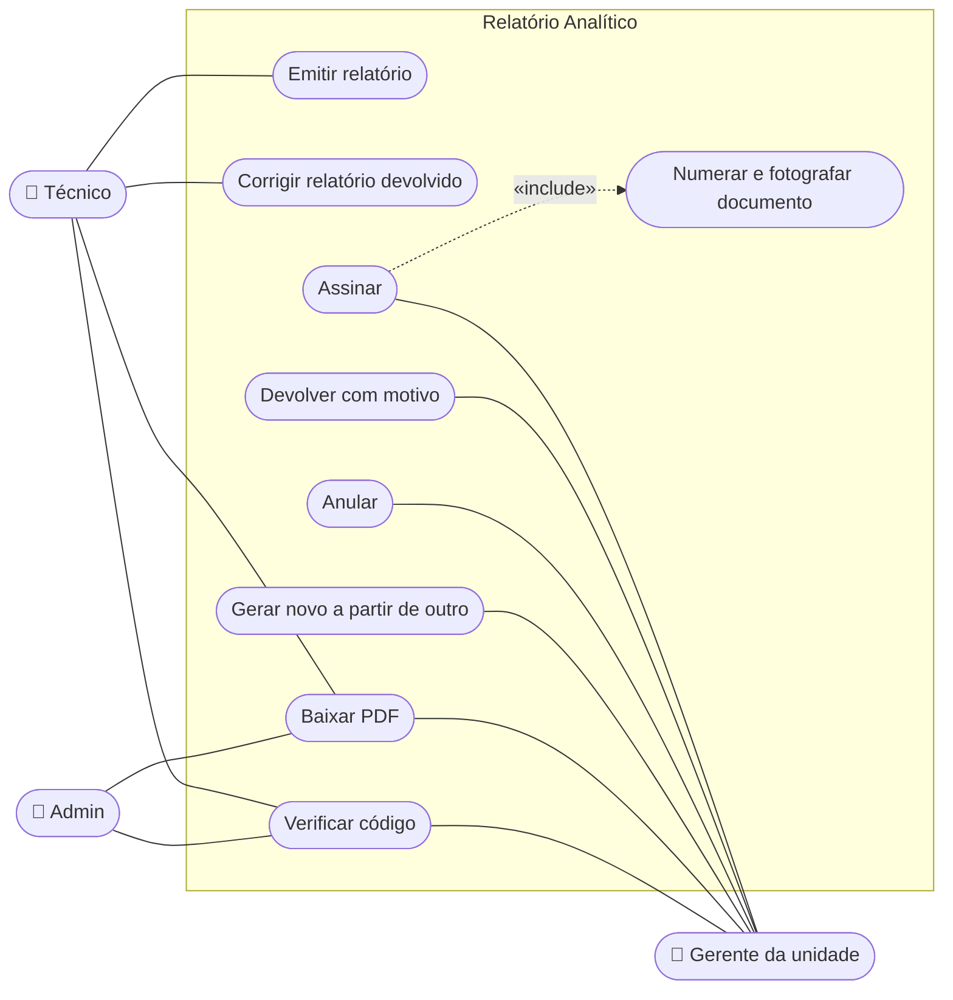

# Casos de uso

[← Voltar ao README](../README.md)

## Atores

| Ator | Descrição |
| --- | --- |
| **Técnico** | Perfis `tecnico`, `tecnico_impressora` e `tecnico_eletronica`. Os dois últimos herdam tudo do técnico e ganham o módulo próprio. |
| **Gerente** | Coordenador de uma unidade. Gere a unidade dele. |
| **Admin** | Administra usuários e unidades e vê tudo. Nas OS e nos Relatórios Analíticos só visualiza. |
| **Sistema** | Regras automáticas: status automáticos, devolução ao estoque, numeração, notificações. |
| **Telegram (@CosupBot)** | Ator externo que entrega as notificações e faz o vínculo da conta. |

> O Mermaid não tem um tipo próprio para casos de uso. Os diagramas abaixo usam a notação de fluxograma: atores à esquerda e casos de uso como elipses dentro do limite do sistema.

## Diagramas de casos de uso por ator

Para não embaralhar as linhas, há um diagrama para cada ator. O Telegram participa de UC20 e UC21 em todos eles.

### Técnico

> UC07 e UC08 só para `tecnico_impressora`. Em UC09, qualquer técnico abre o chamado; só o `tecnico_eletronica` atende na bancada.

### Gerente

### Admin

> O admin também **visualiza** as OS (UC04) e os Relatórios Analíticos (UC16 a UC18), mas não executa nenhuma ação neles.

## Diagrama da OS (detalhe com «include» e «extend»)

## Diagrama do Relatório Analítico

---

## Descrição dos casos de uso

Cada caso tem: atores, pré-condições, fluxo principal, fluxos alternativos (FA) ou de exceção (FE) e pós-condições.

### UC01 – Fazer login

- **Atores:** todos.
- **Pré-condição:** o usuário está cadastrado.
- **Fluxo principal:**
  1. O usuário informa usuário e senha. Pode clicar no olho para ver a senha.
  2. O sistema confere a senha.
  3. O sistema devolve o token e os dados do usuário (perfil e unidade).
  4. O sistema abre o Painel Inicial com o menu do perfil.
- **FE1 – Senha errada:** o sistema responde "Credenciais inválidas" sem dizer se o erro foi no usuário ou na senha.
- **FE2 – 3 erros seguidos:** o sistema bloqueia o usuário por 10 s. Cada novo bloqueio dobra o tempo (20 s, 40 s...), até 24 h. A tela mostra quanto falta.
- **Pós-condição:** o usuário está autenticado, e o socket de notificações conecta com o token.

### UC02 – Gerenciar usuários e unidades

- **Ator:** admin.
- **Fluxo principal:**
  1. O admin abre **Usuários** ou **Unidades**.
  2. O admin cadastra, edita ou exclui o registro. Para usuários, informa nome, login, e-mail, telefone, perfil e unidade.
  3. O sistema valida (login e e-mail únicos; sigla da unidade única) e grava.
- **FA1 – Redefinir senha:** o admin define uma nova senha para o usuário.
- **FE1 – Exclusão bloqueada:** uma unidade ou usuário com registros ligados não pode ser excluído, e o sistema avisa.

### UC03 – Abrir OS

- **Ator:** técnico.
- **Pré-condição:** o técnico está vinculado a uma unidade.
- **Fluxo principal:**
  1. O técnico abre **Nova Solicitação**.
  2. O técnico informa o nº do GLPI, o patrimônio, o setor do equipamento, o responsável, a justificativa e o tipo da OS (consumo ou teste).
  3. O técnico adiciona as peças e as quantidades.
  4. O sistema reserva as peças, descontando do estoque principal (consumo) ou de teste, e cria a OS como **Pendente**, com as peças em **Pendente almoxarifado**.
  5. O sistema notifica os gerentes da unidade e o técnico responsável (se for outro), confirma ao técnico e atualiza as telas de OS e de estoque.
- **FE1 – Estoque insuficiente:** o sistema recusa e diz qual peça faltou. Nada é gravado.
- **FE2 – Gerente ou admin:** a opção não aparece no menu, e a API recusa.

### UC04 – Gerenciar OS

- **Ator principal:** gerente. **Secundário:** admin, só para visualizar.
- **Fluxo principal:**
  1. O gerente abre **Gerenciar OS** e filtra ou busca.
  2. O gerente abre uma OS da unidade dele.
  3. Em cada peça, o gerente informa o **nº do pedido SIPAC** e o **almoxarifado**.
  4. O gerente muda o status: Pendente → **Em atendimento**; Pronta para vistoria → **Concluída**.
  5. O sistema valida a transição, grava e notifica o técnico.
- **FA1 – Cancelar:** o gerente cancela uma OS aberta. O sistema devolve cada peça ao estoque certo (ver UC05) e marca as peças como Canceladas.
- **FA2 – Imprimir:** o gerente emite o documento da OS.
- **FE1 – OS de outra unidade, ou admin:** os botões ficam desabilitados, e a API responde 403.
- **FE2 – Transição inválida:** o sistema recusa (ex.: de Pendente direto para Concluída).
- **FE3 – Concluir sem SIPAC:** se alguma peça não cancelada estiver sem nº do pedido SIPAC ou sem almoxarifado, o sistema não conclui e lista as peças que faltam.

### UC05 – Movimentar peças da OS

- **Atores:** técnico e gerente.
- **Observação:** "técnico" aqui é quem abriu a OS **ou** o técnico responsável; os dois podem agir e recebem as notificações.
- **Fluxo principal:**
  1. O gerente marca a peça como **Disponível para retirada** (ou volta para Pendente almoxarifado).
  2. O técnico confirma **Recebi**. Uma peça de consumo fica "Em posse do técnico"; uma de teste fica **Aguardando devolução**.
  3. O técnico usa a peça e marca a OS como **Pronta para vistoria**.
- **FA1 – Peça de teste funcionou:** o técnico escolhe "Funcionou (pedir definitiva)", e a peça vira consumo.
- **FA2 – Devolver com defeito:** o técnico devolve e informa o motivo, que é obrigatório. A peça vai para **Devolvida**; se for de consumo, soma no estoque de defeito.
- **FA3 – Aceitar devolução:** o gerente aceita. Uma peça de teste boa volta ao estoque de teste; uma de teste com defeito vai para o estoque de defeito.

### UC06 – Manter estoque de peças

- **Atores:** gerente, admin. O técnico só consulta.
- **Fluxo principal:** abrir **Catálogo de Peças**, buscar, e cadastrar, editar ou excluir uma peça, informando as quantidades de estoque, teste e defeito e o preço.
- **FE1 – Código SIPAC repetido na mesma unidade:** o sistema recusa.

### UC07 – Gerenciar impressoras e atendimentos

- **Atores:** técnico de impressoras, gerente, admin.
- **Fluxo principal:**
  1. Cadastrar ou editar a impressora em **Impressoras**.
  2. Em **Atend. Técnico**, registrar o atendimento com GLPI, impressora, visita e parecer.
  3. Atualizar o status: Aguardando assistência → Em atendimento → Aguardando peça → Concluído.
- **FA1 – Impressora reserva:** informar os dados da impressora reserva e as datas de disponibilização e retirada.
- **FA2 – Impressão redirecionada:** registrar que a unidade imprime temporariamente em outra.

### UC08 – Controlar suprimentos

- **Atores:** técnico de impressoras, gerente, admin.
- **Fluxo principal:**
  1. Em **Entrada de Toners**, registrar a entrada por cor (preto, ciano, magenta, amarelo) e de unidades de imagem.
  2. Em **Saída Suprimentos**, registrar a saída por impressora, com GLPI.
  3. O sistema atualiza o estoque e guarda o histórico.
- **FA1 – Corrigir estoque:** informar a quantidade correta e a justificativa.
- **FA2 – Reportar erro:** o técnico envia uma divergência aos gestores.
- **FE1 – Saída maior que o estoque:** o sistema recusa.

### UC09 – Manutenção eletrônica

- **Atores:** técnicos, técnico de eletrônica, gerente, admin.
- **Fluxo principal:**
  1. Quem precisa abre o chamado (equipamento, patrimônio, GLPI, problema) e escolhe o técnico responsável.
  2. O técnico de eletrônica clica em **Iniciar**, e o status vai para Em manutenção.
  3. O técnico clica em **Finalizar** e escreve o laudo, que é obrigatório. O status vai para Concluído.
  4. O sistema notifica quem abriu o chamado e os gerentes.
- **FE1 – Laudo vazio:** o sistema não finaliza.

### UC10 – Gerenciar patrimônio

- **Atores:** gerente, admin.
- **Fluxo principal:**
  1. Em **Inventário de Bens**, buscar e filtrar os bens.
  2. Cadastrar, editar, anexar foto ou excluir um bem.
  3. Transferir um ou mais bens para outra unidade.
  4. Atribuir um bem a um técnico, devolver ou transferir entre técnicos.
  5. O sistema grava o histórico de cada ação.
- **FA1 – Importar SIPAC:** em **Importar SIPAC**, enviar a planilha (CSV ou XLSX) ou o PDF e escolher a unidade. O sistema cria os bens novos e informa quantos encontrou.

### UC11 – Auditoria física (levantamento)

- **Atores:** gerente, admin.
- **Fluxo principal:**
  1. Em **Auditoria Física**, iniciar um levantamento.
  2. Escolher a unidade e bipar ou digitar os tombamentos.
  3. O sistema marca cada bem como **OK**, ou como **Inconsistente** se o bem for de outra unidade.
  4. Finalizar o levantamento.
- **FE1 – Bem já conferido** ou **não encontrado:** o sistema avisa e não registra de novo.

### UC12 – Lançar produção

- **Ator:** técnico.
- **Fluxo principal:**
  1. Em **Minha Produção**, escolher um ou mais serviços do catálogo e as quantidades.
  2. Opcionalmente, vincular a uma OS, um atendimento de impressora ou uma manutenção eletrônica, e informar GLPI e patrimônio.
  3. O sistema calcula e **congela** o valor do serviço, o das peças da OS e o total.
- **FA1 – Excluir lançamento:** o próprio técnico, o gerente ou o admin pode excluir.

### UC13 – Manter catálogo de serviços

- **Atores:** gerente, admin.
- **Fluxo principal:** em **Catálogo de Serviços**, cadastrar ou editar um serviço (nome, categoria, valor estimado), ou desativar.

### UC14 – Ver Dashboard de Produção

- **Atores:** gerente, admin.
- **Fluxo principal:** em **Relatórios**, escolher o período e, no caso do admin, a unidade. O sistema mostra indicadores, ranking de técnicos, serviços e gráficos.

### UC15 – Montar relatório em PDF

- **Atores:** gerente, admin.
- **Pré-condição:** estar na tela **Relatórios**, seção "Montar Relatório", abaixo do dashboard.
- **Fluxo principal:**
  1. Escolher a **fonte de dados**: produção, OS, peças da OS, estoque, impressoras, suprimentos, patrimônio, equipamentos inservíveis, usuários etc.
  2. Escolher o tipo:
     - **Detalhado:** marcar as colunas;
     - **Cruzado (agrupado):** escolher o campo das linhas, o das colunas e o valor (contagem ou soma).
  3. Aplicar filtros e período. O admin também escolhe a unidade.
  4. Clicar em **Ver prévia**. O sistema monta a tabela com totais.
  5. Clicar em **Baixar PDF**. O PDF sai com o cabeçalho em todas as páginas e "Página X de Y".
- **FA1 – Salvar modelo:** dar nome à montagem e marcar se é compartilhada. Depois, basta escolher em "📂 Carregar modelo salvo…".
- **FE1 – Gerente tenta outra unidade:** o servidor sempre força a unidade do gerente.

### UC16 – Emitir Relatório Analítico

- **Ator:** técnico.
- **Fluxo principal:**
  1. Em **Relatório Analítico**, clicar em **Novo**.
  2. Digitar a lista de equipamentos e patrimônios.
  3. Revisar a minuta em PDF, que sai com a marca "MINUTA".
  4. Enviar. O relatório fica **Pendente**, e o sistema notifica os gerentes da unidade.
- **FA1 – Corrigir devolvido:** o técnico vê o motivo, corrige e reenvia. O relatório volta a Pendente.
- **FA2 – Excluir:** o técnico pode excluir enquanto o relatório não foi assinado.

### UC17 – Assinar ou devolver Relatório Analítico

- **Ator:** gerente da unidade do relatório.
- **Fluxo principal:**
  1. Abrir o relatório pendente.
  2. Conferir e confirmar o **cargo** (o sistema sugere o último usado).
  3. Clicar em **Assinar**.
  4. O sistema dá o próximo número da unidade no ano, guarda a "fotografia" do documento e gera o código de verificação.
  5. O PDF final fica disponível, e o técnico é notificado.
- **FA1 – Devolver:** informar o motivo. O relatório fica **Devolvido** para o técnico corrigir.
- **FE1 – Gerente de outra unidade ou admin:** sem permissão.

### UC18 – Anular ou duplicar Relatório Analítico

- **Ator:** gerente da unidade.
- **Fluxo principal (anular):** abrir um relatório assinado, clicar em **Anular** e informar o motivo. O PDF passa a sair com a marca "ANULADO", e o número continua reservado.
- **Fluxo alternativo (duplicar):** clicar em **Gerar novo**. O sistema cria um relatório novo, Pendente, com os mesmos equipamentos, ligado ao original.

### UC19 – Verificar autenticidade

- **Atores:** todos os usuários logados.
- **Fluxo principal:** em **Relatório Analítico → Verificar**, digitar o código impresso no PDF. O sistema mostra número, unidade, data, assinante, situação e equipamentos.
- **FE1 – Código inexistente:** "Documento não encontrado".

### UC20 – Receber notificações

- **Atores:** todos; o Telegram como ator externo.
- **Fluxo principal:**
  1. Um evento acontece: nova OS, mudança de status, relatório para assinar etc.
  2. O sistema grava a notificação, envia pelo socket para quem está on-line (aparece um card) e, se a pessoa ligou o canal, pelo Telegram.
  3. O usuário abre o sininho e marca como lida.
- **FA1 – Canal desligado:** o sistema não envia por aquele canal.

### UC21 – Vincular Telegram

- **Atores:** todos; o Telegram.
- **Fluxo principal:**
  1. Abrir **Configurar Telegram e Alertas** no cabeçalho.
  2. O sistema gera um link de uso único e mostra o botão **Abrir @CosupBot**.
  3. O usuário abre o link e toca em **Iniciar**.
  4. O bot recebe o token, liga o chat à conta e responde confirmando. A tela atualiza sozinha.
- **FA1 – Vínculo manual:** o usuário toca em Iniciar no bot, recebe o ID e cola em **Seu Telegram Chat ID**.
- **FE1 – Link usado ou inválido:** o bot pede para gerar um novo link.
