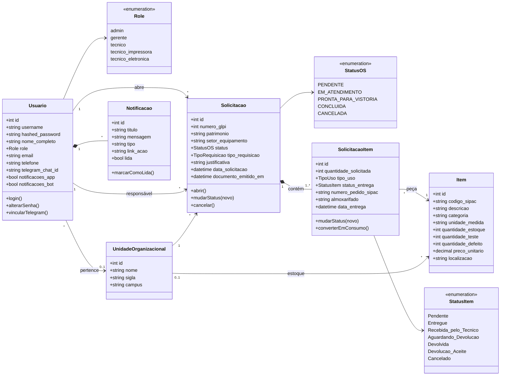
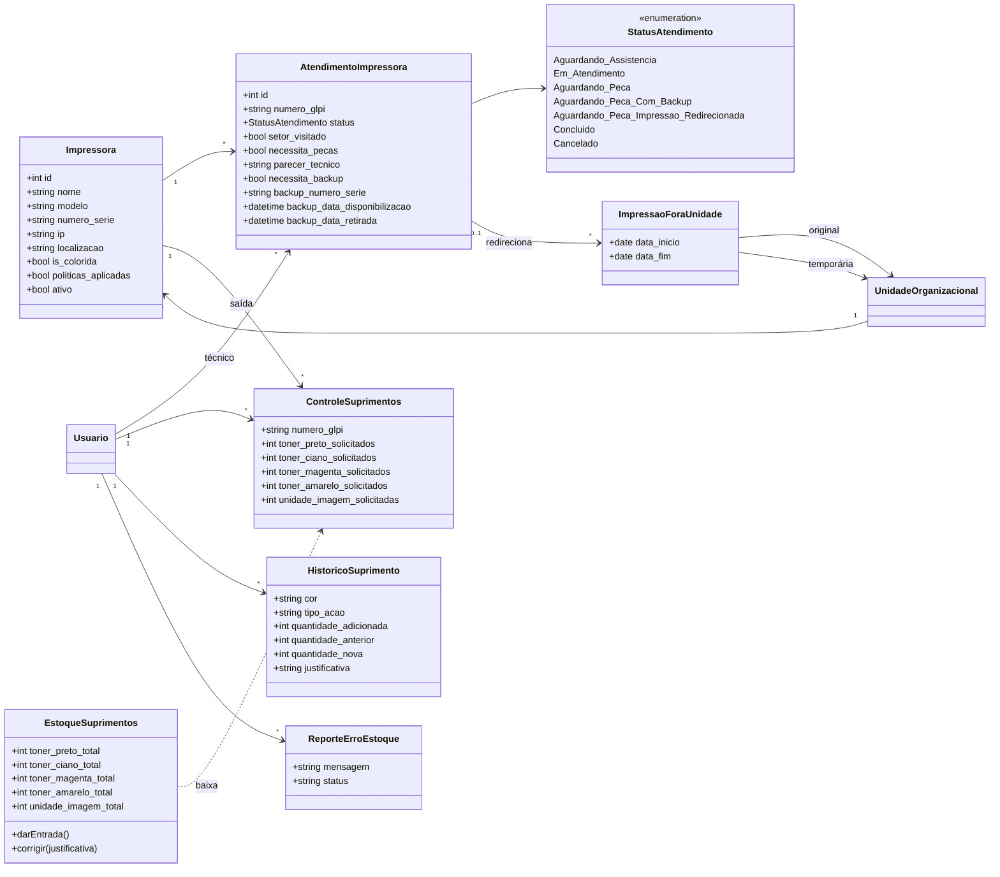
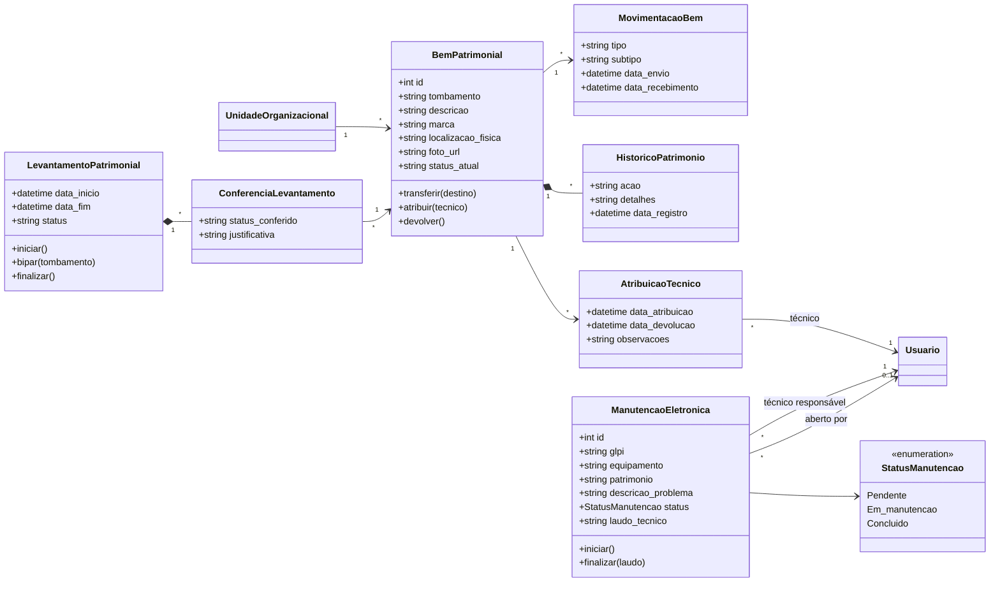
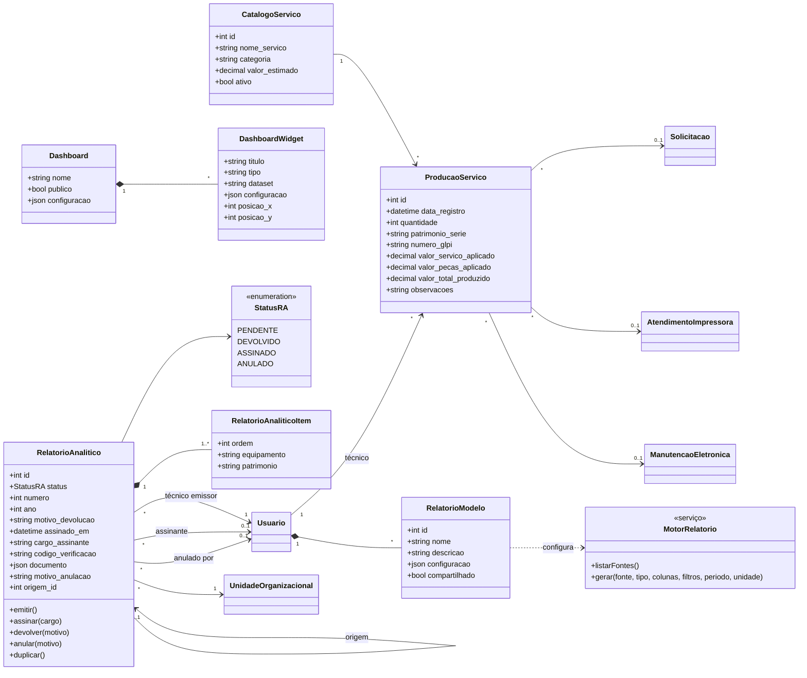

# Diagrama de classes

[← Voltar ao README](../README.md)

O diagrama mostra as classes do domínio (os modelos do Prisma, em `Gestio_back/prisma/schema.prisma`) com os atributos principais e as operações que o backend oferece para cada uma. Foi dividido por módulo para ficar legível.

## Núcleo: usuários, unidades, OS e estoque

## Impressoras e suprimentos

## Patrimônio e manutenção eletrônica

## Produção, relatórios e Relatório Analítico

## Observações

- Os status da OS e da peça são texto no banco; os valores válidos e as transições estão em `Gestio_back/src/rules/solicitacaoRules.ts`.
- Os métodos listados correspondem às rotas da API (ver [Arquitetura](05-arquitetura.md#rotas-da-api)). No código, eles estão nos controllers, e não nos modelos, porque o Prisma gera só a camada de dados.
- `MotorRelatorio` não é tabela: é o serviço em `src/relatorios/motor.ts`, que lê as fontes de `src/relatorios/fontes.ts`.
