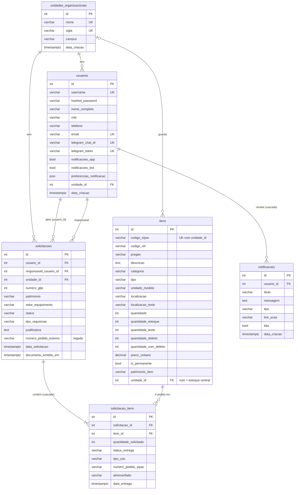
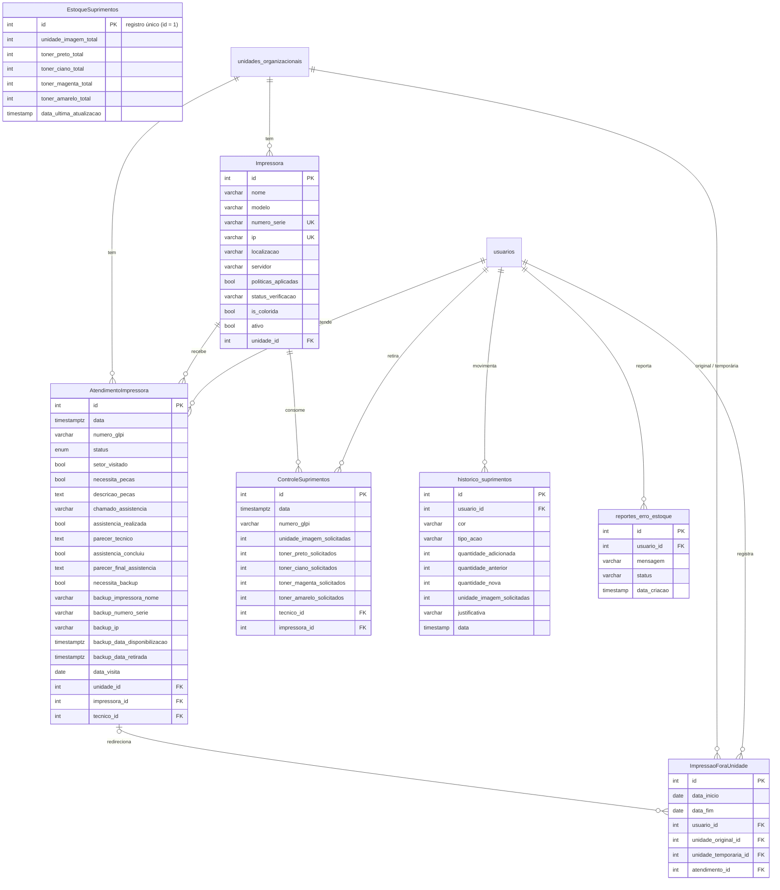
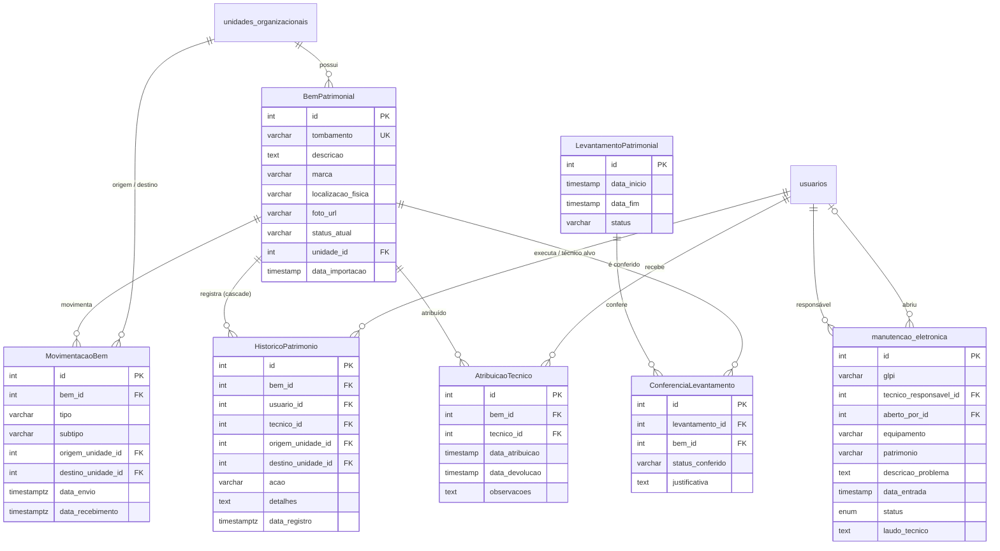
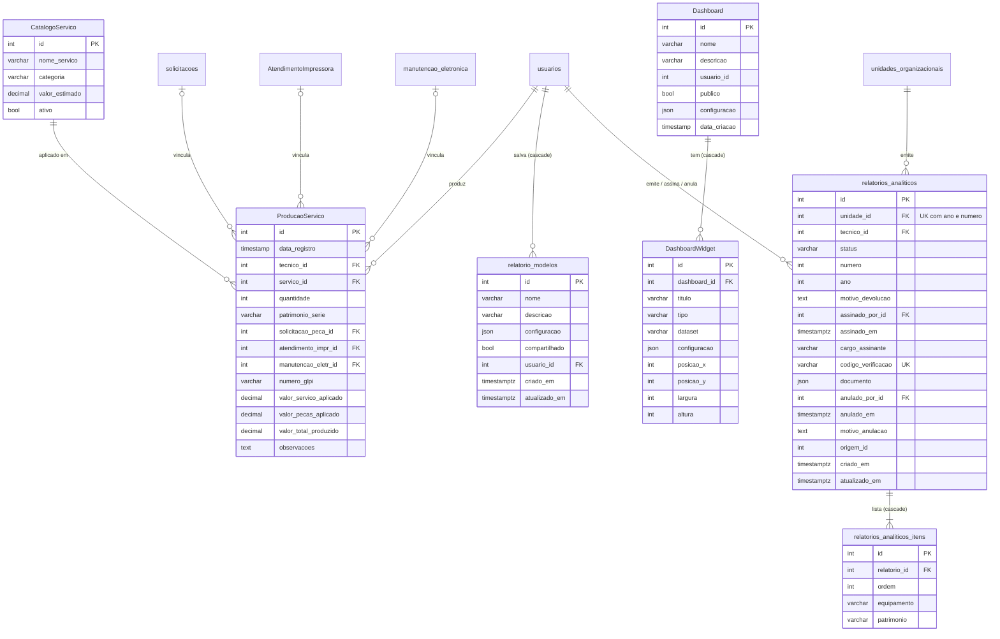

# Diagrama entidade-relacionamento

[← Voltar ao README](../README.md)

Banco PostgreSQL, gerado pelas migrações do Prisma (`Gestio_back/prisma/migrations`). Os nomes abaixo são os das tabelas no banco. PK = chave primária, FK = chave estrangeira, UK = único.

## Núcleo

## Impressoras e suprimentos

## Patrimônio e manutenção eletrônica

## Produção, relatórios e Relatório Analítico

## Índices e restrições importantes

| Tabela | Restrição | Motivo |
| --- | --- | --- |
| `itens` | único (`codigo_sipac`, `unidade_id`) | A mesma peça não se repete no estoque de uma unidade |
| `relatorios_analiticos` | único (`unidade_id`, `ano`, `numero`) | Numeração sem repetição por unidade e ano, mesmo com duas assinaturas ao mesmo tempo |
| `relatorios_analiticos` | único `codigo_verificacao` | Cada documento assinado tem um código só dele |
| `relatorios_analiticos_itens` | índice `patrimonio` | Levantamento de equipamentos inservíveis por patrimônio |
| `BemPatrimonial` | único `tombamento` | Um tombamento identifica um bem |
| `Impressora` | únicos `numero_serie` e `ip` | Não cadastrar a mesma impressora duas vezes |
| `usuarios` | únicos `username`, `email`, `telegram_chat_id`, `telegram_token` | Login e vínculo com o Telegram sem ambiguidade |
