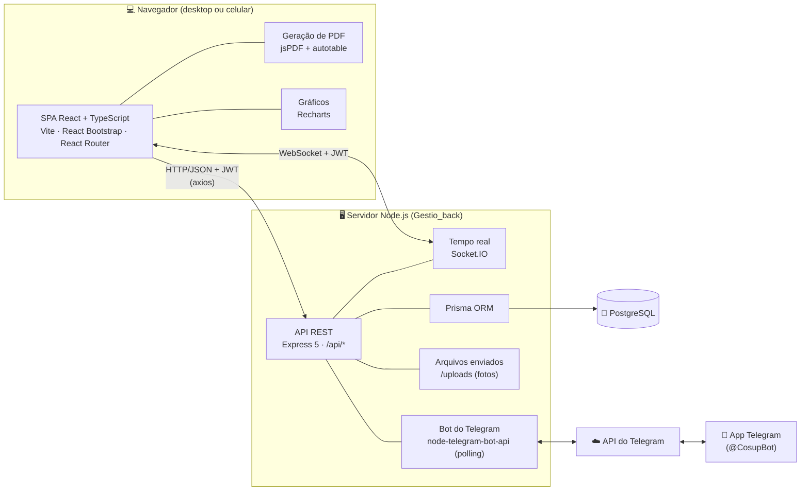
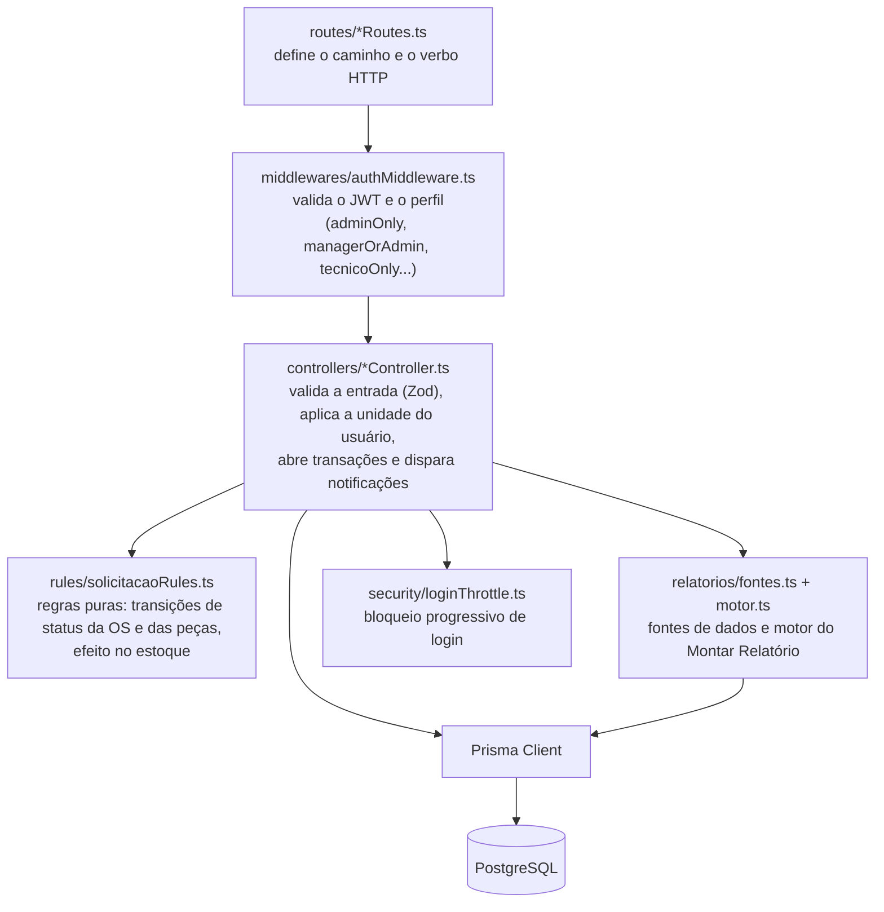
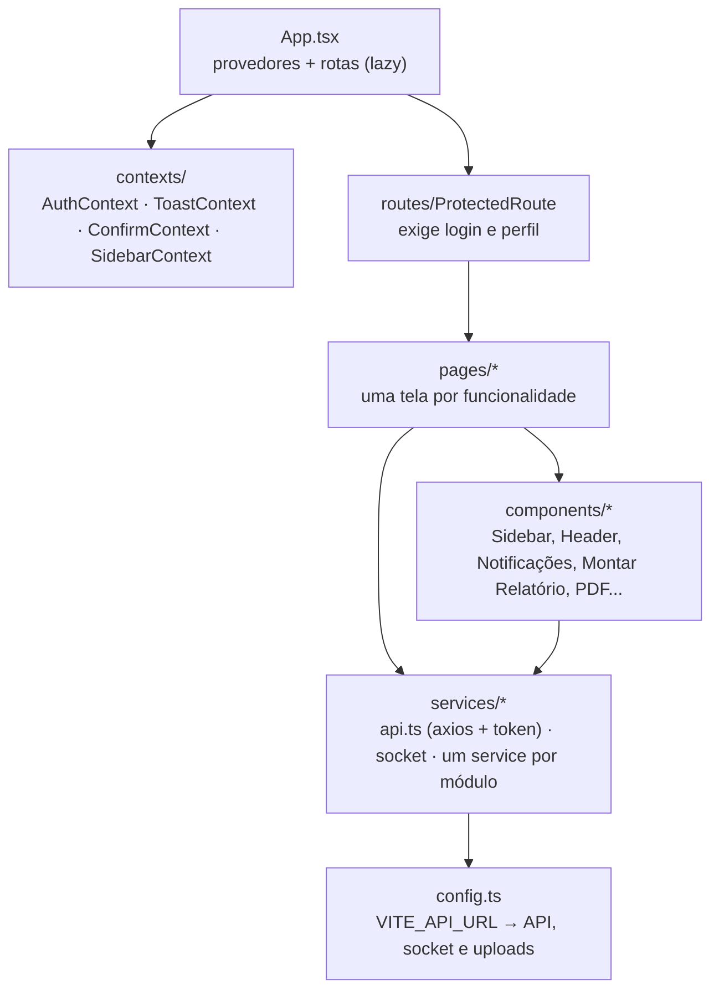
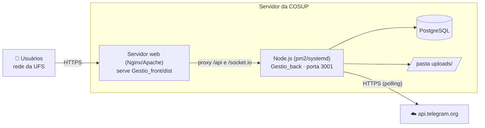
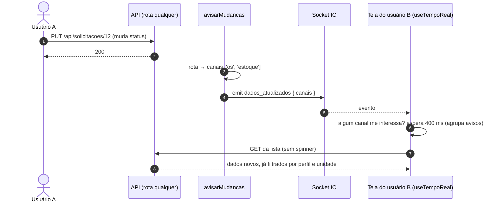

# Arquitetura

[← Voltar ao README](../README.md)

O COSUP+ é uma aplicação web cliente-servidor:

- **Front-end:** uma SPA (Single Page Application) em React, que roda no navegador.
- **Back-end:** uma API REST em Node.js/Express, com uma conexão em tempo real (Socket.IO) e o bot do Telegram no mesmo processo.
- **Banco de dados:** PostgreSQL, acessado pelo Prisma ORM.

## Visão geral (componentes)

## Camadas do back-end

Cada requisição passa por estas camadas, de cima para baixo:

## Camadas do front-end

## Implantação

- O front é estático: depois do `npm run build`, basta servir a pasta `dist/` e devolver o `index.html` em qualquer rota.
- O back precisa de acesso ao banco e, se o Telegram for usado, saída para `api.telegram.org`.
- **Só uma instância** do back pode usar o mesmo token do bot (polling). Duas instâncias dão erro 409.
- O bloqueio de login fica na memória do processo. Ao reiniciar o servidor, os bloqueios são zerados.

## Segurança

| Ponto | Como é feito |
| --- | --- |
| Senhas | Hash com argon2. Hashes bcrypt antigos continuam aceitos. |
| Autenticação | JWT assinado com `JWT_SECRET`, enviado no cabeçalho `Authorization: Bearer`. |
| Autorização | Middlewares por perfil nas rotas, e checagem de unidade nos controllers. O front só esconde o que o perfil não usa. |
| Escopo por unidade | O gerente recebe sempre a própria unidade, que vem do token e não do que o navegador envia. |
| Força bruta | 3 erros: espera de 10 s, dobrando a cada novo bloqueio até 24 h (`security/loginThrottle.ts`). |
| Tempo real | Socket.IO aceita a conexão só com JWT válido, e a sala `user_<id>` vem do token. |
| Uploads | multer com tipos permitidos, 20 MB no máximo e 1 arquivo por vez. A pasta `/uploads` exige login de gerente ou admin. |
| Entrada | Validação com Zod nos controllers. |
| Segredos | Só no `.env` do back. O front recebe só `VITE_API_URL`. |

## Tecnologias

| Camada | Tecnologia | Uso |
| --- | --- | --- |
| Front | React 18, TypeScript, Vite | SPA e build |
| Front | React Router 7 | Rotas e proteção por perfil |
| Front | React Bootstrap, Bootstrap 5, react-bootstrap-icons | Interface responsiva |
| Front | axios, socket.io-client | API e tempo real |
| Front | jsPDF, jspdf-autotable (carregados sob demanda) | PDFs: relatórios, Relatório Analítico |
| Front | Recharts | Gráficos do dashboard e das análises |
| Front | react-hook-form, date-fns, react-to-print | Formulários, datas, impressão da OS |
| Back | Node.js, Express 5, TypeScript | API REST |
| Back | Prisma 6, PostgreSQL | ORM, migrações, banco |
| Back | Zod | Validação |
| Back | jsonwebtoken, argon2, bcrypt | Autenticação |
| Back | Socket.IO | Notificações em tempo real |
| Back | node-telegram-bot-api | @CosupBot |
| Back | multer, SheetJS (xlsx), pdf-parse | Upload e importação do SIPAC |

## Rotas da API

Todas começam com `/api` e, exceto o login, exigem `Authorization: Bearer <token>`.

| Prefixo | Principais rotas | Quem acessa |
| --- | --- | --- |
| `/auth` | `POST /login`, `PUT /change-password` | Todos |
| `/usuarios` | `GET /`, `POST /`, `PUT /:id`, `DELETE /:id`, `PUT /reset-password` | Escrita: admin |
| `/unidades` | `GET /`, `POST /`, `PUT /:id`, `DELETE /:id` | Escrita: admin |
| `/solicitacoes` | `GET /`, `GET /latest`, `GET /:id`, `POST /` (técnico), `PUT /:id`, `PUT /item/:itemId/converter-consumo` | Por perfil e unidade |
| `/itens` | `GET /`, `POST /`, `PUT /:id`, `DELETE /:id` | Escrita: gerente e admin |
| `/gestao-impressoras` | `/impressoras`, `/atendimentos`, `/estoque`, `/suprimentos`, `/suprimentos/historico`, `/suprimentos/corrigir`, `/suprimentos/reportar-erro` | Técnico de impressoras, gerente, admin |
| `/manutencao-eletronica` | `GET /`, `POST /`, `PATCH /:id/iniciar`, `PATCH /:id/finalizar`, `PATCH /:id/status`, `PUT /:id` | Ações de bancada: técnico de eletrônica, gerente, admin |
| `/patrimonio` | `GET /`, `POST /`, `PUT /:id`, `DELETE /:id`, `POST /importar`, `POST /:id/foto`, `POST /transferencia`, `POST /atribuir`, `POST /devolver`, `GET /:id/historico`, `/levantamento/iniciar`, `/levantamento/atual`, `/levantamento/bipar`, `/levantamento/finalizar` | Gerente, admin |
| `/servicos` | `GET /catalogo`, `POST /catalogo`, `PUT /catalogo/:id` | Escrita: gerente e admin |
| `/producao` | `GET /producao`, `POST /producao`, `DELETE /producao/:id` | Técnico (a própria), gerente e admin |
| `/relatorios` | `/solicitacoes`, `/graficos`, `/estoque`, `/patrimonio/historico`, `/producao-dashboard`, `/personalizado/fontes`, `/personalizado/gerar`, `/personalizado/modelos` | Gerente, admin |
| `/relatorios-analiticos` | `GET /`, `GET /:id`, `POST /`, `PUT /:id`, `DELETE /:id`, `POST /:id/assinar`, `/devolver`, `/anular`, `/duplicar`, `GET /cargo-sugerido`, `GET /verificar/:codigo` | Regras no controller |
| `/analise` | `GET /catalog`, `POST /query`, `GET/POST /dashboards` | Gerente, admin |
| `/estatisticas` | `GET /` | Todos (painel inicial) |
| `/notificacoes` | `GET /`, `PUT /:id/lida`, `PUT /lidas-todas`, `PUT /preferencias`, `GET /telegram/gerar-link`, `GET /telegram/status` | Todos |

### Eventos em tempo real (Socket.IO)

| Evento | Direção | Quando |
| --- | --- | --- |
| `dados_atualizados` `{ canais: [...] }` | servidor → todos os usuários conectados | Depois de **qualquer** alteração bem-sucedida na API (POST, PUT, PATCH ou DELETE com status < 400) |
| `nova_notificacao` | servidor → sala `user_<id>` | Uma notificação foi criada para o usuário; o radar mostra o card |
| `telegram_vinculado` | servidor → sala `user_<id>` | O bot terminou de vincular a conta ao Telegram |

#### Atualização automática das telas

- **Back:** `src/realtime/avisarMudancas.ts` é um middleware único, registrado antes das rotas. Ele traduz o caminho da rota em canais. Rotas novas só precisam entrar no mapa `REGRAS`. As rotas que usam POST só para consultar (`/relatorios/personalizado/gerar`, `/analise/query`, `/auth/*`) não avisam.
- **Front:** `src/hooks/useTempoReal.ts`. Cada tela chama `useTempoReal(['os', 'estoque'], () => carregar(true))`. O hook agrupa avisos seguidos numa recarga só e, se a conexão cair e voltar, recarrega para não perder nada.
- O aviso **não leva dados**, só o nome da área. Cada tela busca de novo pela API, que aplica as regras de perfil e unidade. Assim ninguém recebe dados que não pode ver.

| Canal | Rotas que disparam | Telas que escutam |
| --- | --- | --- |
| `os` | `/solicitacoes`, `/itens` | Gerenciar OS, Painel, Análises, Relatórios |
| `estoque` | `/solicitacoes`, `/itens` | Catálogo de Peças, Nova Solicitação, Gerenciar OS, Painel |
| `impressoras` | `/gestao-impressoras/impressoras`, `/atendimentos` | Impressoras, Atend. Técnico, Saída Suprimentos |
| `atendimentos` | `/gestao-impressoras/atendimentos` | Atend. Técnico, Painel |
| `suprimentos` | `/gestao-impressoras/estoque`, `/suprimentos` | Entrada de Toners, Saída Suprimentos, Painel |
| `manutencao` | `/manutencao-eletronica` | Fila de Manutenção, Painel |
| `patrimonio` | `/patrimonio` | Inventário de Bens, Auditoria Física, Painel |
| `levantamento` | `/patrimonio/levantamento` | Auditoria Física |
| `servicos` | `/servicos` | Catálogo de Serviços, Minha Produção, Relatórios |
| `producao` | `/producao` | Minha Produção, Relatórios, Painel |
| `relatorios_analiticos` | `/relatorios-analiticos` | Relatório Analítico, Painel |
| `relatorio_modelos` | `/relatorios/personalizado/modelos` | Montar Relatório (lista de modelos) |
| `usuarios` | `/usuarios` | Usuários, Painel |
| `unidades` | `/unidades` | Unidades, Usuários, Inventário de Bens, Painel |
