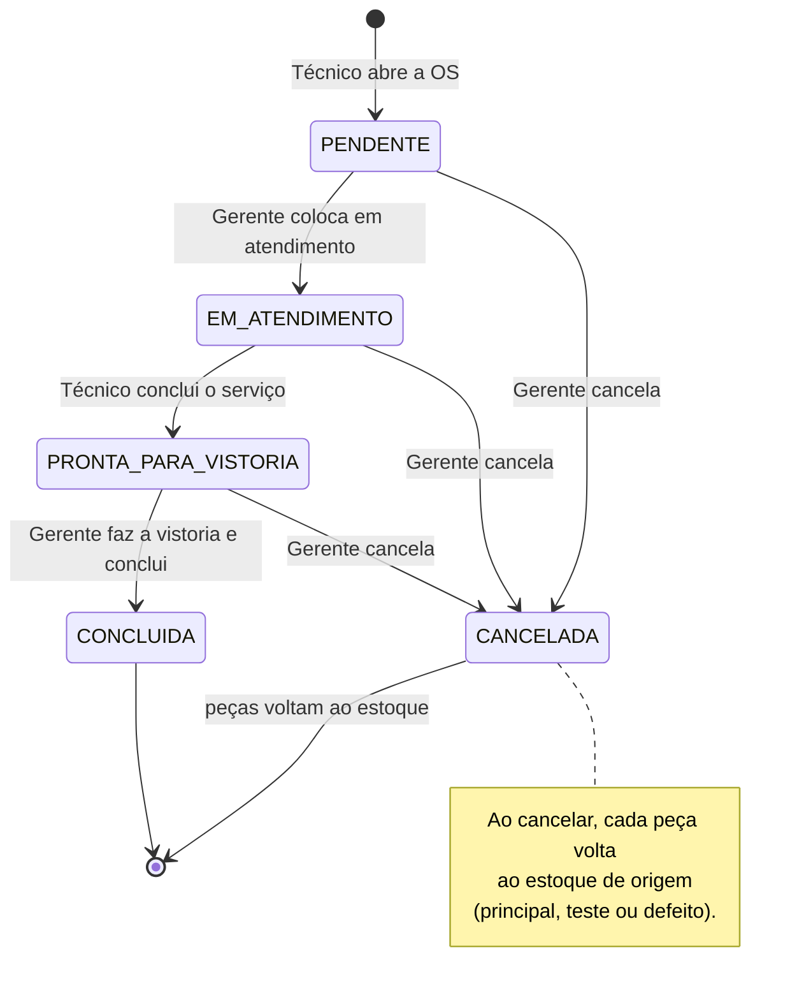
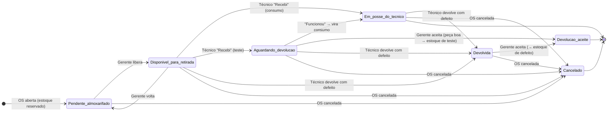
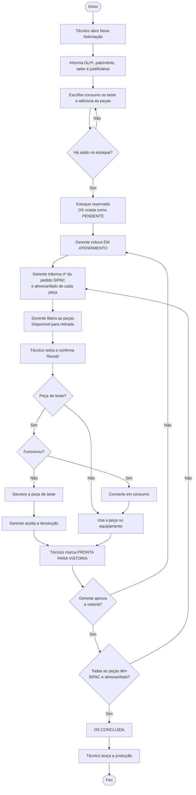
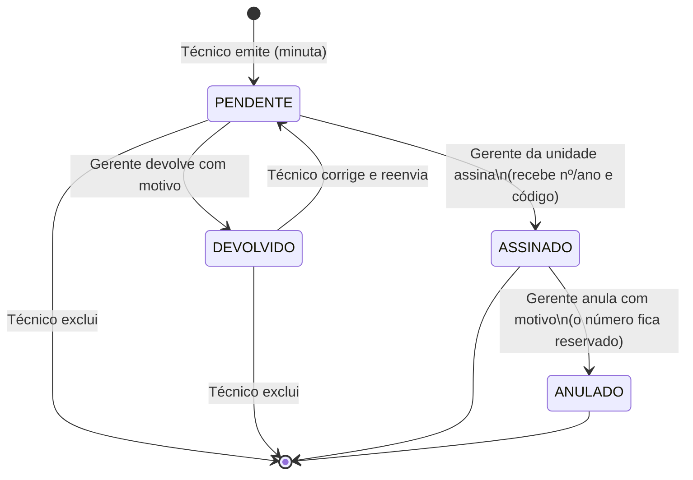
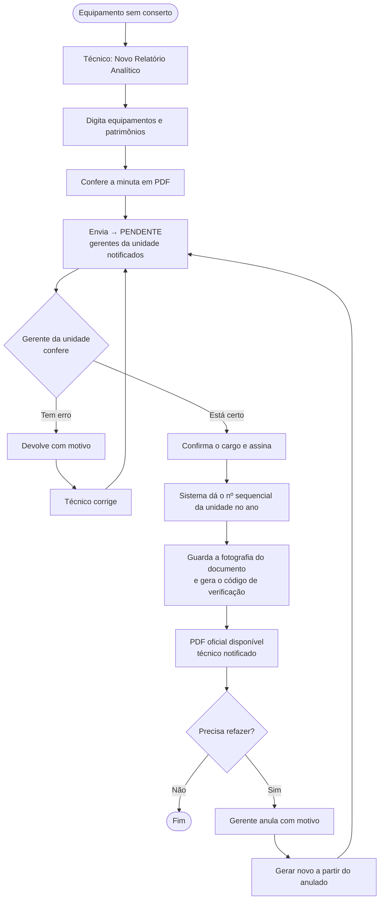
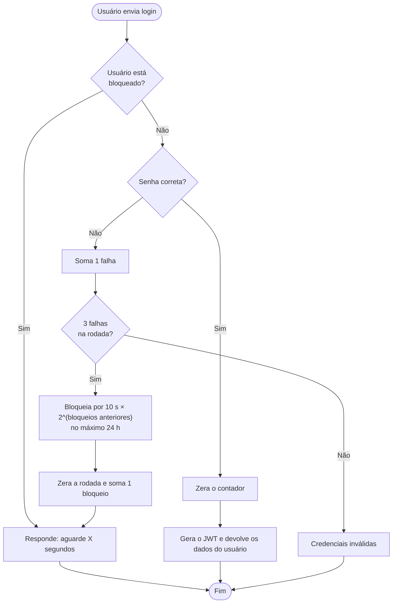
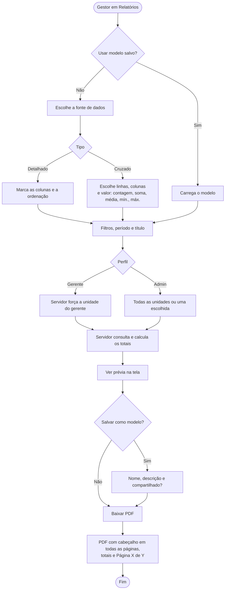
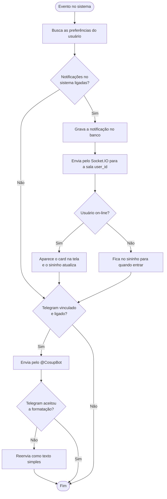
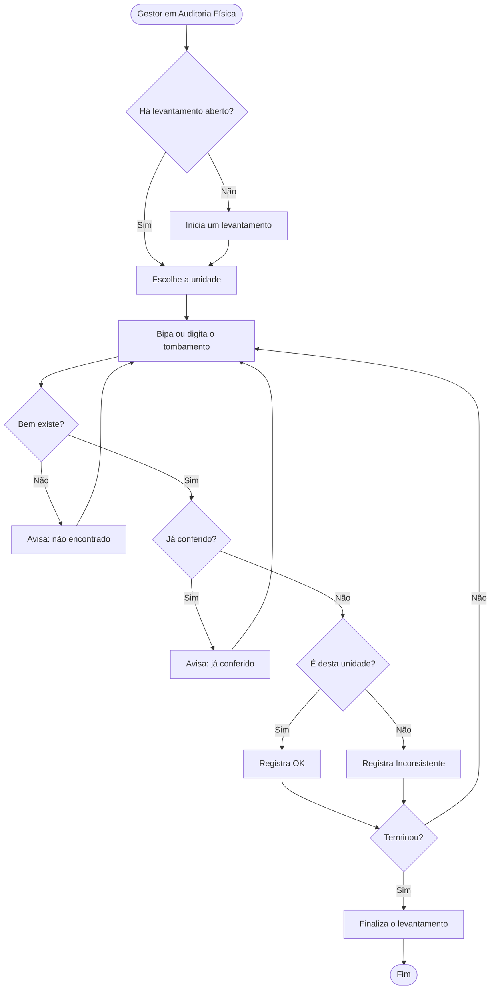
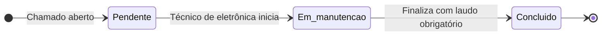

# Diagramas de fluxo

[← Voltar ao README](../README.md)

## 1. Ciclo de vida da Ordem de Serviço (OS)

O admin vê todos os estados, mas não executa nenhuma transição. O gerente só executa transições em OS da própria unidade.

## 2. Ciclo de vida da peça da OS

### Efeito no estoque de cada movimento

| Movimento | Peça de consumo | Peça de teste |
| --- | --- | --- |
| Técnico devolve com defeito (motivo obrigatório) | +1 no estoque de **defeito** | nenhum (aguarda o aceite) |
| Gerente aceita devolução de peça boa | — | +1 no estoque de **teste** |
| Gerente aceita devolução de peça com defeito | nenhum (já contou na devolução) | +1 no estoque de **defeito** |
| OS cancelada com a peça pendente, disponível ou com o técnico | +1 no estoque **principal** | +1 no estoque de **teste** |
| OS cancelada com a peça devolvida | nenhum | +1 no estoque de **defeito** |

## 3. Abertura e atendimento da OS (fluxo de atividades)

## 4. Relatório Analítico

## 5. Login com bloqueio progressivo

Sem nenhuma falha por 24 h, o histórico de bloqueios é esquecido.

## 6. Montar Relatório

## 7. Notificações

## 8. Auditoria física (levantamento)

## 9. Manutenção eletrônica

