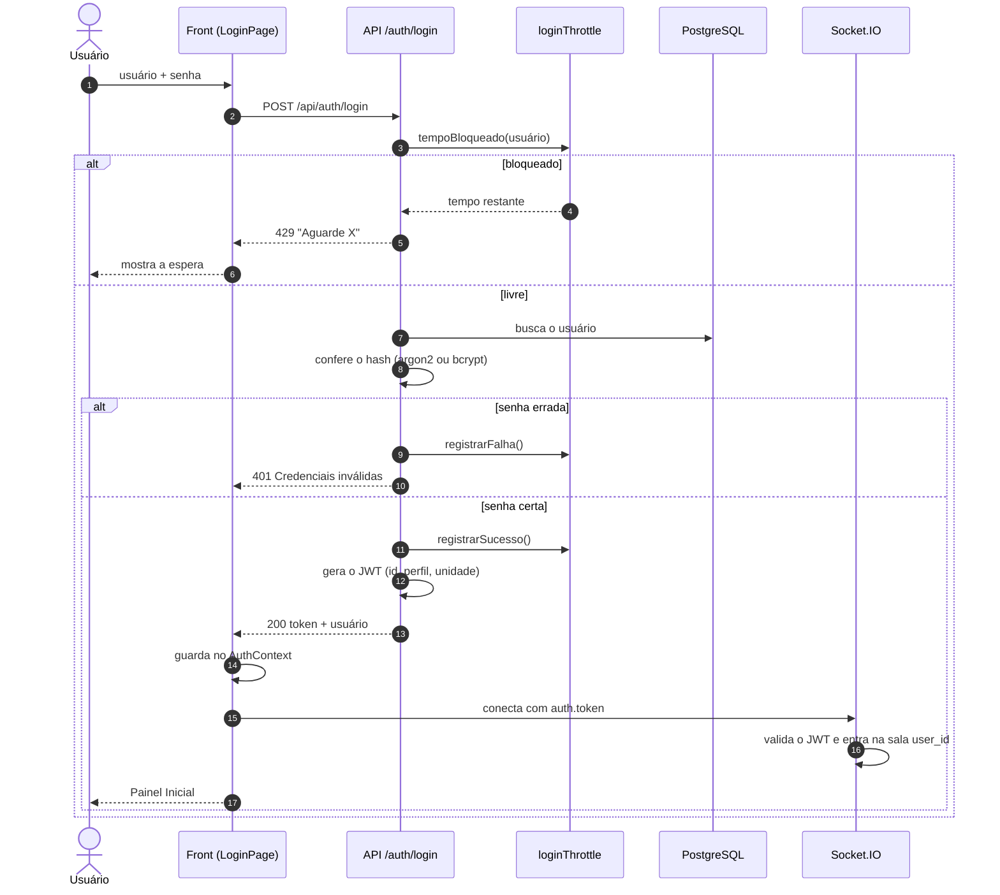
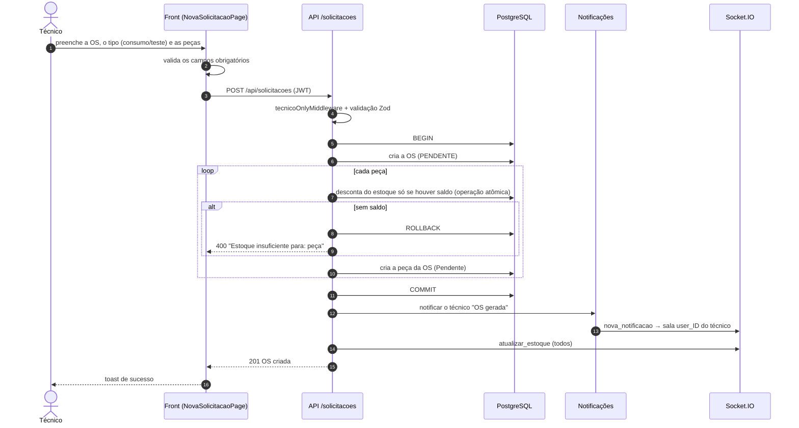
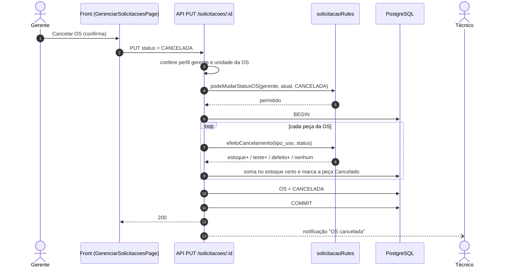
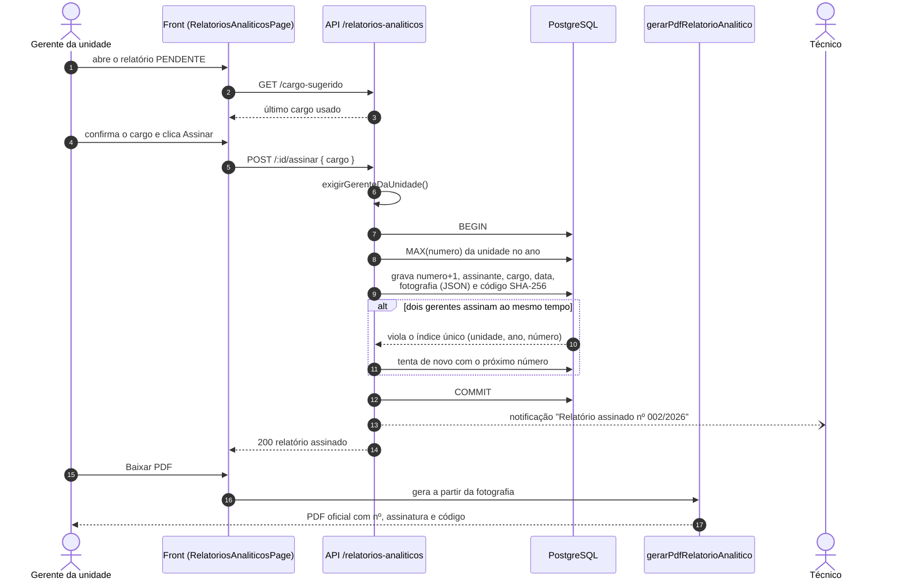
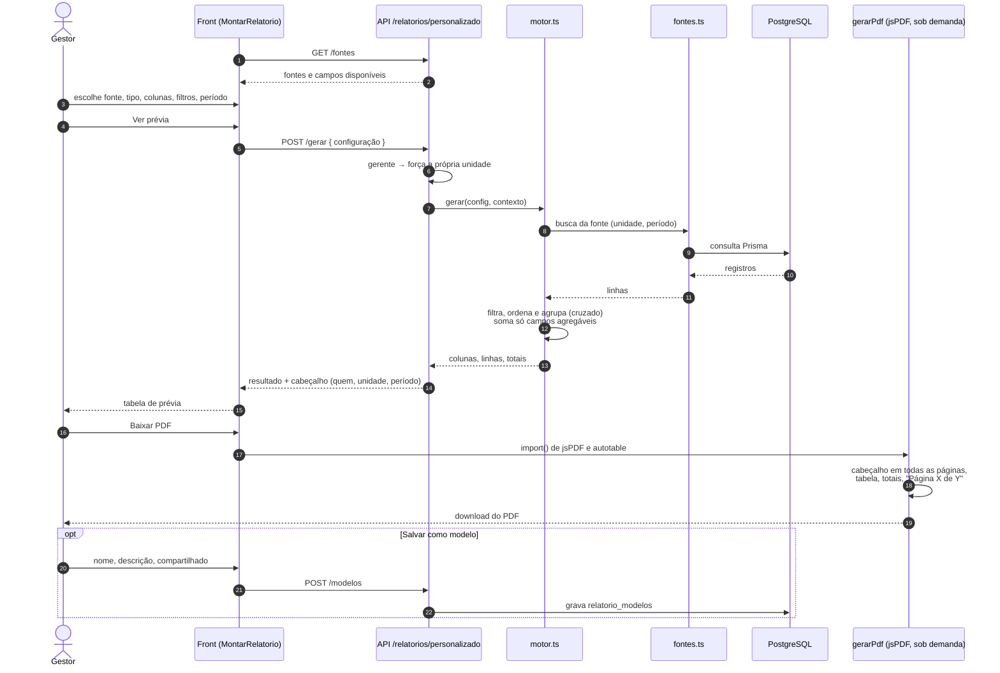
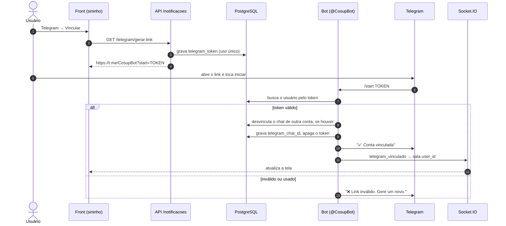
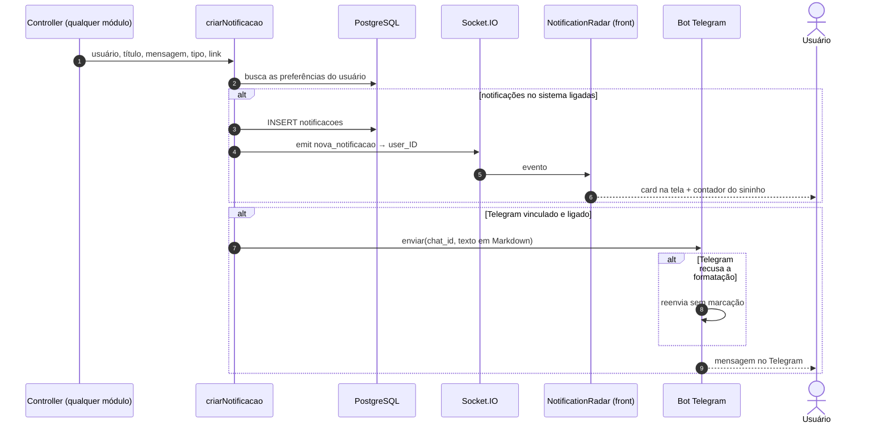

# Diagramas de sequência

[← Voltar ao README](../README.md)

## 1. Login

## 2. Abrir uma OS

## 3. Cancelar uma OS (devolução ao estoque)

## 4. Assinar um Relatório Analítico

## 5. Montar Relatório e baixar PDF

## 6. Vincular Telegram

## 7. Notificação em tempo real

